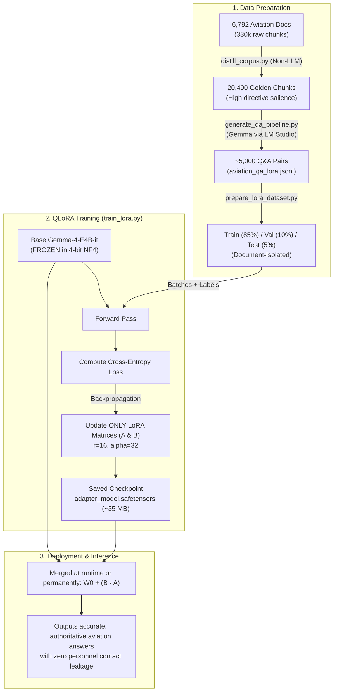

# LoRA & QLoRA Adaptation: Technical Explainer

An in-depth explanation of **Low-Rank Adaptation (LoRA)**, **Quantized LoRA (QLoRA)**, and how they are implemented in this aviation regulatory adaptation pipeline.

---

## 1. The Core Problem with Full Fine-Tuning

When you adapt a model like **Gemma (4 billion parameters)** using traditional full parameter fine-tuning:

1. **Massive Memory Overhead:** 
   Backpropagation requires storing not only the 4 billion model weights, but also their **gradients** and **optimizer states** (standard AdamW tracks two 32-bit floating-point states for every parameter: momentum and variance). At 16-bit precision, this requires **35–45 GB of GPU VRAM**, making training impossible on consumer GPUs like an NVIDIA GeForce RTX 5060 Ti (16 GB).
2. **Catastrophic Forgetting:** 
   Unconstrained gradient updates across all layers overwrite the model's pre-trained general linguistic fluency, conversational polish, and broader reasoning skills.
3. **Bulky Storage & Deployment:** 
   Every fine-tuned experiment produces an entire duplicate ~8–10 GB model file to store and distribute.

---

## 2. Mathematical Foundations of LoRA (The Low-Rank Decomposition)

In any neural network layer (e.g., self-attention or feed-forward networks), processing an input vector $x$ involves matrix multiplication with a pre-trained weight matrix $W_0 \in \mathbb{R}^{d \times k}$:

$$h = W_0 \cdot x$$

During fine-tuning, the updated weight is represented as $W = W_0 + \Delta W$, where $\Delta W$ is the accumulated task-specific adjustment:

$$h = (W_0 + \Delta W) \cdot x$$

The fundamental insight behind LoRA (Hu et al., Microsoft Research) is that **the intrinsic rank of the task-specific update matrix $\Delta W$ is very small**—meaning you do not need a full $d \times k$ parameter space to teach an LLM domain-specific aviation regulations and operational logic.

Instead of directly training $\Delta W$, LoRA:
1. **Freezes the original base weights $W_0$ completely** (zero gradients flow into the base model).
2. Decomposes the update matrix $\Delta W$ into **two low-rank matrices, $A$ and $B$**:

$$\Delta W = B \cdot A \quad \text{where} \quad B \in \mathbb{R}^{d \times r}, \quad A \in \mathbb{R}^{r \times k}, \quad r \ll \min(d, k)$$

```text
       Original Dense Weight W0                      LoRA Adapter
      (FROZEN: e.g. 4096 x 4096)           Matrix B         Matrix A
           [              ]                (4096 x 16)      (16 x 4096)
           [              ]        +       [    ]     x     [--------]
           [              ]                [    ]           [--------]
     ~16.7 Million Parameters              ~65k params     ~65k params
                                                Total = ~131k params (99.2% reduction!)
```

### Key Parameters:
- **Rank ($r = 16$):** The inner dimensionality of matrices $A$ and $B$. A rank of 16 provides an optimal balance between expressive capacity and parameter efficiency for domain adaptation.
- **Scaling Factor ($\alpha = 32$):** The output of the adapter is scaled by $\frac{\alpha}{r}$:
  $$h = W_0 \cdot x + \frac{\alpha}{r} (B \cdot A) \cdot x$$
  With $\alpha = 32$ and $r = 16$, the adapter update has a scaling factor of $2.0$, ensuring gradient stability as rank changes.
- **Initialization:** Matrix $A$ is initialized from a Gaussian distribution $\mathcal{N}(0, \sigma^2)$, while Matrix $B$ is initialized to all zeros. Thus, at step 0 of training, $B \cdot A = 0$, guaranteeing that the model begins with its exact pre-trained baseline behavior.

---

## 3. What is QLoRA? (Quantized LoRA)

Our fine-tuning implementation in [`train_lora.py`](train_lora.py) uses **QLoRA** (Dettmers et al.), taking memory optimization to state-of-the-art levels:

1. **4-Bit NormalFloat (NF4) Quantization:**
   - The frozen base weights ($W_0$) are quantized into an information-theoretically optimal 4-bit representation (NF4) tailored for zero-mean, normally distributed weights.
   - Gemma 4B drops from **~8 GB down to ~2.5 GB of VRAM**.
2. **Double Quantization (DQ):**
   - Quantizes the quantization constants themselves (saving ~0.37 bits per parameter, or an extra ~400 MB of VRAM).
3. **Paged Optimizers (`paged_adamw_8bit`):**
   - Uses CUDA memory paging to automatically offload optimizer states to system RAM during temporary gradient activation spikes, preventing Out-Of-Memory (OOM) crashes.
4. **Adapter Backpropagation:**
   - Only the small adapter matrices $A$ and $B$ (stored in 16-bit precision) receive gradient updates during backpropagation.

**Result on an RTX 5060 Ti (16 GB VRAM):** Training executes comfortably within **8–10 GB of VRAM**, leaving ample headroom for sequence lengths up to 2,048 tokens.

---

## 4. Which Layers are Adapted in Aviation?

In [`train_lora.py`](train_lora.py), LoRA adapters are injected into all primary linear projection layers:

```python
target_modules = [
    "q_proj", "k_proj", "v_proj", "o_proj",    # Self-Attention
    "gate_proj", "up_proj", "down_proj"        # Feed-Forward Network (MLP)
]
```

- **Attention Layers (`q_proj`, `k_proj`, `v_proj`, `o_proj`):**
  Teaches the model **where to direct its attention** when encountering dense aeronautical phraseology, acronyms, and procedural conditions (e.g., `EGPWS Warning Mode 2`, `CVR readout analysis`, `RVR minima`).
- **MLP / Feed-Forward Layers (`gate_proj`, `up_proj`, `down_proj`):**
  Stores **factual domain knowledge, numerical thresholds, and regulatory authority mappings** (e.g., distinguishing between ICAO Annexes, EASA CS specifications, and FAA Federal Aviation Regulations).

---

## 5. End-to-End Pipeline Architecture



---

## 6. Comparison: Full Fine-Tuning vs. QLoRA

| Metric | Full Parameter Fine-Tuning | QLoRA Approach |
| :--- | :--- | :--- |
| **GPU VRAM Required** | 35–45 GB (Requires A100 / H100) | **8–11 GB (Runs on RTX 5060 Ti / 4060 Ti)** |
| **Trainable Parameters** | 100% (~4,000,000,000) | **~0.4% (~15,000,000)** |
| **Adapter File Size** | Full Model (~8 GB) | **Lightweight Adapter (~35 MB)** |
| **Catastrophic Forgetting** | Significant risk | Effectively eliminated |
| **Modular Deployment** | Requires full model per task | Can hot-swap multiple adapters on a single base model |

---

## 7. Serving the Adapted Model

After training, the adapter (`models/aviation-gemma-lora/`) can be used in two ways:

1. **Dynamic Runtime Merging:** Load the base model once in memory and apply the ~35 MB adapter weights on the fly (ideal for multi-tenant serving).
2. **Permanent Export:** Use `model.merge_and_unload()` in `peft` to permanently bake the $\Delta W$ matrix directly into the base weights, then export to **GGUF format** for execution in LM Studio, Ollama, or llama.cpp.

---

## 8. Hardware Stability & The 262K Vocabulary Embedding Trap

When training modern high-capacity open models like `google/gemma-4-E4B-it` on consumer GPUs (e.g. 16 GB RTX 5060 Ti), standard QLoRA recipes encounter a subtle memory failure mode:

### The Pitfall in Standard PEFT:
PEFT's default [`prepare_model_for_kbit_training`](train_lora.py) executes:
```python
for param in model.parameters():
    if (param.dtype == torch.float16 or param.dtype == torch.bfloat16) and param.__class__.__name__ != "Params4bit":
        param.data = param.data.to(torch.float32)
```
- Gemma-4 features a multimodal vocabulary of **262,144 tokens**. Its unquantized embedding tables (`embed_tokens` and `embed_tokens_per_layer`) take **6.66 GB in native `bfloat16`**.
- Blindly upcasting these frozen embedding weights to `float32` doubles their memory requirement to **13.3+ GB**.
- Combined with the base model weights, PyTorch reserves **over 21.9 GB of VRAM**. On a 16 GB card, Windows WDDM begins thrashing virtual memory over PCIe, locking up the display driver and freezing the machine during dataset preparation.

### Our Solution (`prepare_kbit_model_safe`):
- We freeze base model parameters and register gradient tracking hooks (`model.enable_input_require_grads()`) **without** casting frozen embedding matrices to `float32`.
- Non-quantized weights remain in native **`bfloat16`**, slashing peak reserved VRAM from **21.92 GB down to 8.91 GB**.
- This leaves **~6 GB of clean VRAM headroom** on a 16 GB card for activations and paged 8-bit AdamW optimizer states.

---

## 9. Evaluating LoRA Efficacy: The Fictional Regulatory Benchmark

Domain-specific LLMs cannot be properly evaluated by perplexity or general benchmarks (e.g. MMLU) alone. Aviation regulatory analysis requires:
1. **Preserving Legal Modality:** Strict differentiation between obligations (*shall*), discretionary permissions (*may*), triggers (*where*), and exclusive preconditions (*only where*).
2. **Epistemic Restraint:** Refusing to assume an alternative source is authorized merely because it is technically available, avoiding arbitrary numerical deadlines for vague standards like *"without undue delay"*, and avoiding external rule hallucinations (e.g. FAA/ICAO).
3. **Decision Tree Logic:** Mapping degraded and contingency states without skipping procedural preconditions.

Our benchmark suite (`compare_lora.py`) tests both the Base Model and the LoRA Model on an identical authoritative, fictional provision (R-17) and scores output across 5 quantitative dimensions:
- **Structural Completeness (20%)**
- **Regulatory Modality (20%)**
- **Decision Branching (20%)**
- **Epistemic Restraint (20%)**
- **Analytical Precision & Density (20%)**

