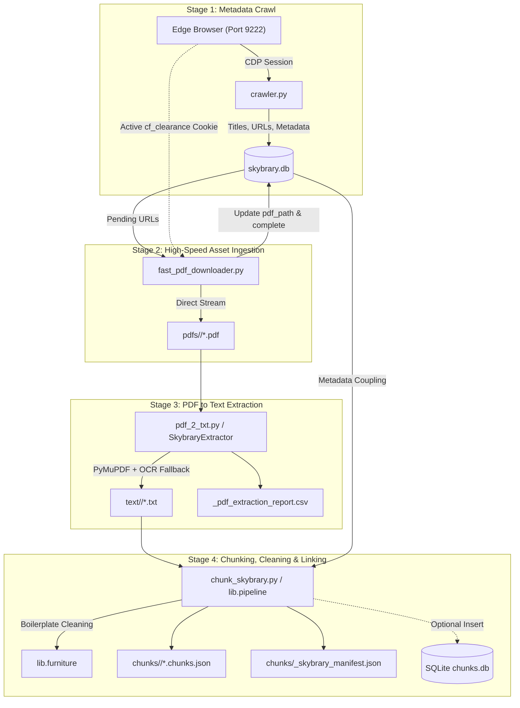

# SKYbrary Bookshelf Ingestion & Chunking Pipeline

This pipeline automates the complete lifecycle for ingesting, downloading, extracting, cleaning, and chunking the **SKYbrary Bookshelf** (~5,000 aviation safety publications, accident investigation reports, EASA/FAA guidelines, and EUROCONTROL technical manuals).

The resulting chunks are formatted with rich contextual metadata (`embedding_text`, page breadcrumbs, and sequential chaining) directly compatible with the project's semantic vector and SQLite FTS5 search engines.

---

## 1. System Architecture & Data Flow



---

## 2. Pipeline Stages

### Stage 1: Metadata Crawling (`crawler.py`)

#### How to Start the Browser with Remote Debugging (Port 9222)
The crawler and fast downloader attach to an existing browser window via the Chrome DevTools Protocol (CDP). Using a dedicated `--user-data-dir` ensures the debugging session runs cleanly without conflicting with your everyday browser windows, while permanently persisting Cloudflare verification cookies across runs:

**For Microsoft Edge:**
```powershell
& "C:\Program Files (x86)\Microsoft\Edge\Application\msedge.exe" --remote-debugging-port=9222 --user-data-dir="c:\Projects\Regs\ingestion\skybrary_bookshelf\skybrary_browser_profile"
```

**For Google Chrome:**
```powershell
& "C:\Program Files\Google\Chrome\Application\chrome.exe" --remote-debugging-port=9222 --user-data-dir="c:\Projects\Regs\ingestion\skybrary_bookshelf\skybrary_browser_profile"
```

#### Workflow:
1. Run either command above to open the browser window.
2. Navigate to `https://skybrary.aero` and pass any initial Cloudflare verification / Turnstile prompt.
3. Keep this browser window open in the background.
4. Run the crawler or downloader.

#### What `crawler.py` Does:
- Attaches to the active browser session via WebSocket (`http://127.0.0.1:9222/json`).
- Navigates SKYbrary index pages and publication summaries at human-like pacing to avoid bot blocks.
- Populates `skybrary.db` with publication titles, categories, authors, dates, summary URLs, and binary download URLs.

### Stage 2: High-Speed Asset Downloader (`fast_pdf_downloader.py`)
- **Cloudflare Bypass**: Reuses the active `cf_clearance` cookie and browser fingerprint from the open Edge session.
- **Direct Multi-Threading**: Downloads files directly over HTTP without triggering browser tab navigations or popups.
- **Thread-Safe Atomic Writes**: Uses unique temporary filenames (`.tmp_<id>_<pid>_<timestamp>.part`) to eliminate Windows file-locking collisions (`WinError 32`).
- **Disk Synchronization**: Automatically syncs existing disk files to `skybrary.db`, preventing duplicate downloads.
- **Collision Disambiguation**: Appends `_{id}` if multiple publications share the identical title.
- **Multi-Tier Retries**:
  - *In-flight*: Retries transient network glitches with exponential backoff (1.5s, 3s).
  - *Database-backed*: Tracks `download_attempts` in SQLite; re-queues failed downloads on subsequent runs until `max_attempts` is reached.

### Stage 3: Robust Text Extraction (`pdf_2_txt.py` / `lib.extractor`)
- **Primary Engine**: High-throughput extraction via PyMuPDF (`fitz`).
- **Page Markers**: Injects explicit delimiters (`--- PAGE X ---`) to enable accurate statutory and page-level citations.
- **OCR Fallback**: Automatically falls back to Tesseract OCR (`C:\Program Files\Tesseract-OCR\tesseract.exe`) if a page lacks a native text layer.
- **Quality Auditing**: Tracks character density, alphanumeric ratio, replacement characters (``), and mojibake signatures.

### Stage 4: Boilerplate Cleaning (`lib.furniture`)
- Two-pass document cleaner removes non-substantive artifacts:
  - Repeating running headers and footers across page boundaries.
  - Page counters (`Page X of Y`, `X / Y`).
  - Regulatory boilerplate (EASA `TE.SDIR` notices, ELI links, Eurocontrol/FSF distribution disclaimers).
- Prevents boilerplate from contaminating semantic vector embeddings.

### Stage 5: Semantic Chunking & Metadata Linking (`chunk_skybrary.py`)
- **Multi-Key Linker (`SkybraryDBLinker`)**: Matches text files to `skybrary.db` using:
  1. Relative subfolder path (`<Category>/<Filename>.txt`)
  2. Disk filename (`<Filename>.pdf` / `.txt`)
  3. Server URL file element (e.g. `36245.pdf`)
  4. Sanitized title stem
- **Context-Enriched Embeddings**: Prepends metadata breadcrumbs to `embedding_text`:
  ```text
  Document: EASA SD 2026-01 Inadequate Protection of SBAS-Based Approach Procedures
  Category: Controlled Flight Into Terrain | Author: EASA | Date: 06.Aug.2026 | Page: 2

  <Verbatim clean paragraph text>
  ```
- **Sequential Linking**: Computes `previous_chunk_id` and `next_chunk_id` for surrounding context expansion.

---

## 3. Directory Structure

```text
ingestion/skybrary_bookshelf/
├── crawler.py                  # CDP-based metadata crawler (writes skybrary.db)
├── fast_pdf_downloader.py      # Cloudflare-bypassing asset downloader
├── chunk_skybrary.py           # CLI entrypoint for chunking & linking
├── skybrary.db                 # SQLite database of publication metadata
│
├── lib/                        # Reusable Python library
│   ├── __init__.py             # Public API exports
│   ├── extractor.py            # SkybraryExtractor (PyMuPDF + OCR)
│   ├── db_linker.py            # SkybraryDBLinker (4-way resolution)
│   ├── furniture.py            # Header/footer/boilerplate cleaner
│   ├── chunker.py              # SkybraryChunker (Page-aware chunking)
│   ├── storage.py              # Storage adapters (JSON & SQLite)
│   └── pipeline.py             # SkybraryPipeline (End-to-end orchestrator)
│
├── pdfs/                       # Downloaded assets by category (PDF, DOCX, XLSX)
│   ├── Controlled Flight Into Terrain/
│   ├── Ground Operations/
│   └── ...
├── text/                       # Extracted UTF-8 text with page markers
└── chunks/                     # Output JSON manifests
    ├── Controlled Flight Into Terrain/
    │   └── <Title>.chunks.json
    └── _skybrary_manifest.json # Consolidated library manifest
```

---

## 4. Operational Commands

### Prerequisites
1. Ensure your browser is launched with remote debugging enabled:
   ```powershell
   & "C:\Program Files (x86)\Microsoft\Edge\Application\msedge.exe" --remote-debugging-port=9222 --user-data-dir="c:\Projects\Regs\ingestion\skybrary_bookshelf\skybrary_browser_profile"
   ```
2. Navigate to `https://skybrary.aero` in that browser window and pass any initial Cloudflare verification.

---

### Step A: Download PDFs

```powershell
# Check how many files remain pending without downloading
python fast_pdf_downloader.py --dry-run

# Synchronize existing files on disk with the database
python fast_pdf_downloader.py --sync-only

# Download next 50 pending files with 3 concurrent workers
python fast_pdf_downloader.py --limit 50 --workers 3

# Download all remaining files in the queue
python fast_pdf_downloader.py --limit 0 --workers 3

# Reset and re-attempt all previously failed files
python fast_pdf_downloader.py --retry-failed --limit 0 --workers 3
```

---

### Step B: Extract Text from PDFs

```powershell
# Fast multi-core native extraction (recommended first pass: 4,800+ files in ~5 minutes)
python pdf_2_txt/pdf_2_txt.py pdfs text --recursive --workers 6

# Extraction with OCR enabled for scanned documents (auto-detects Tesseract, prints live page progress)
python pdf_2_txt/pdf_2_txt.py pdfs text --recursive --workers 4 --ocr
```

---

### Step C: Chunk & Link to Database

```powershell
# Generate per-document JSON chunks in chunks/
python chunk_skybrary.py

# Customize target chunk sizes
python chunk_skybrary.py --target-words 400 --max-words 700

# Write directly into the main project SQLite database
python chunk_skybrary.py --sqlite-out "../data/regulations/sqlite/chunks.db"
```

---

## 5. Reusable Library Usage in Python

The library under `ingestion.skybrary_bookshelf.lib` can be imported across the application:

```python
from pathlib import Path
from ingestion.skybrary_bookshelf.lib import (
    SkybraryPipeline,
    SkybraryExtractor,
    SkybraryDBLinker,
    SkybraryChunker,
)

# 1. End-to-end batch processing
pipeline = SkybraryPipeline(db_path=Path("ingestion/skybrary_bookshelf/skybrary.db"))
summary = pipeline.process_all_texts(
    text_dir=Path("ingestion/skybrary_bookshelf/text"),
    out_dir=Path("ingestion/skybrary_bookshelf/chunks"),
    sqlite_db=Path("ingestion/data/regulations/sqlite/chunks.db"),  # Optional
)

# 2. In-memory single-file processing
extractor = SkybraryExtractor()
res, raw_text = extractor.extract_file(Path("sample.pdf"))

linker = SkybraryDBLinker(Path("ingestion/skybrary_bookshelf/skybrary.db"))
pub_info = linker.find_publication(Path("sample.pdf"))

chunker = SkybraryChunker(target_words=350)
doc_meta, chunks = chunker.chunk_document(pub_info, raw_text)
```

```

---

## 6. Embedding

Once chunks are generated and stored in the SQLite database, you can embed them into the FAISS vector index by running:

```bash
python embed_skybrary.py --db ../data/regulations/sqlite/chunks.db
```

The embedding script is designed to **add or replace without duplicating**:
- It checks the existing FAISS index (`ACT` and `CHUNK` partitions) and safely skips documents and chunks that have already been embedded.
- This allows you to safely re-run the script after adding new documents; only the newly ingested records will be embedded.

---

## 7. Known Edge Cases & Handling

| Scenario | Behavior / Mitigation |
| :--- | :--- |
| **Duplicate Titles** | Automatically disambiguated by saving as `{title}_{id}.pdf`. |
| **Office Attachments** | Supports `.docx`, `.xlsx`, `.pptx` by skipping PDF magic checks and applying ZIP headers. |
| **Broken Server Links (404)** | Marked with `download_status = 'error'`, logged, and retried up to `max_attempts`. |
| **Cloudflare Cookie Expiry** | Re-run `fast_pdf_downloader.py` after refreshing the active Edge tab; new `cf_clearance` is automatically picked up via CDP. |
| **Restricted / Gated Downloads** | Captured by magic byte inspection; prevented from being saved as corrupted `.pdf` files. |
